# Lab 3: Code Coverage & Mutation Testing (EventManager Backend)

## Section 1: Code Coverage with pytest-cov

### 1.1 Baseline test run (original code)

Command: `pytest --cov=app --cov-report=term-missing`

- Platform: win32, Python 3.12.10, pytest 9.1.1
- Collected: 22 items
- Result: **22 passed, 1 warning in 1.39s**
- The warning is a `StarletteDeprecationWarning` about `httpx` / `starlette.testclient`. It does not affect results.

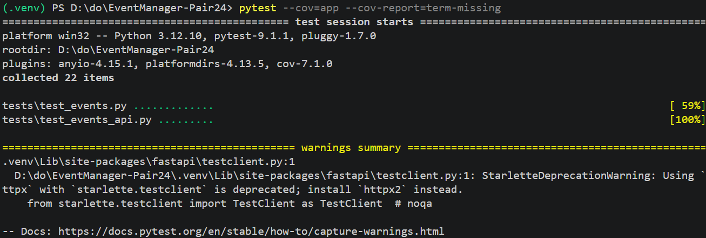

### 1.2 Baseline terminal coverage report

| File | Statements | Missed | Coverage | Missing lines |
|---|---|---|---|---|
| app/database.py | 11 | 4 | 64% | 21-26 |
| app/main.py | 11 | 1 | 91% | 23 |
| app/models.py | 26 | 0 | 100% | |
| app/routers/events.py | 51 | 3 | 94% | 97, 103, 132 |
| app/schemas.py | 28 | 0 | 100% | |
| app/services/search.py | 10 | 0 | 100% | |
| **TOTAL** | **199** | **46** | **77%** | |

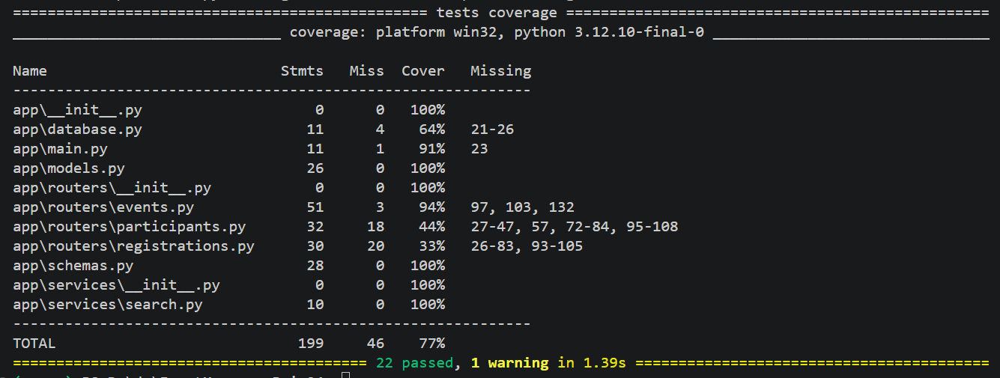

### 1.3 HTML coverage report (baseline)

The HTML report (`htmlcov/index.html`) shows the same numbers as the terminal report: **77%** total.

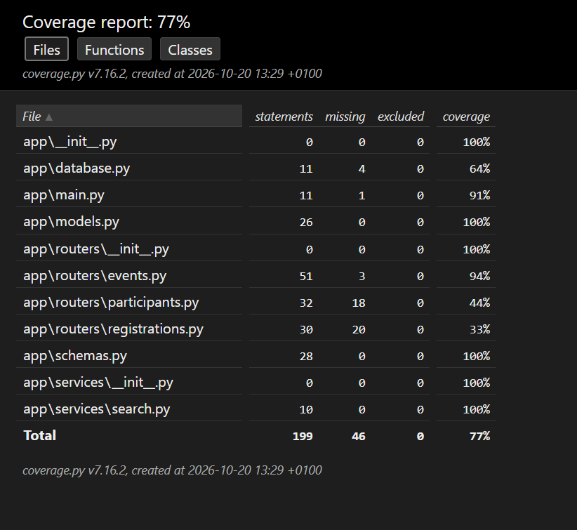

### 1.4 Second test run (after Student A tests)

Command: `python -m pytest`

- Collected: **35 items**
- Result: **35 passed, 1 warning in 0.68s**
- 13 new tests were added (35 total, up from 22).

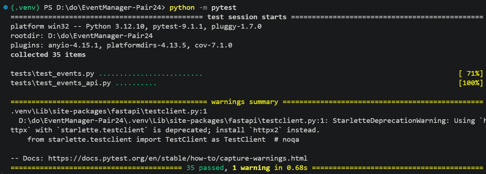

### 1.5 Second coverage run (after Student A tests)

Command: `pytest --cov=app --cov-report=term-missing`

- Result: **35 passed, 1 warning in 1.44s**
- Total coverage: **77%** (no change from baseline)

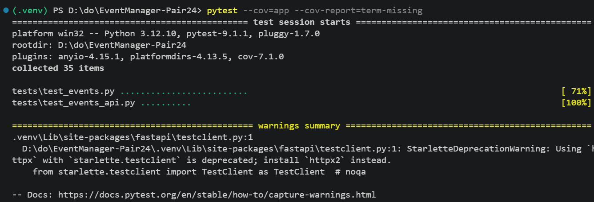

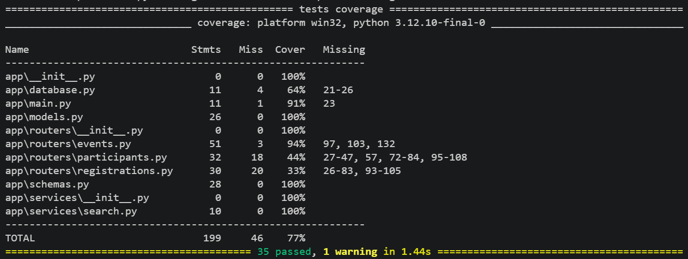

| File | Statements | Missed | Coverage | Missing lines |
|---|---|---|---|---|
| app/database.py | 11 | 4 | 64% | 21-26 |
| app/main.py | 11 | 1 | 91% | 23 |
| app/routers/events.py | 51 | 3 | 94% | 97, 103, 132 |
| **TOTAL** | **199** | **46** | **77%** | |

**Note:** The events error-path lines (97, 103, 132) are still not covered. The 13 new tests did not reach them. See Open Issues in Section 3.

---

## Section 2: Mutation Testing with mutmut

### 2.1 Baseline mutation run (original code)

Command: `mutmut run`

- Baseline test run: Done
- Mutants checked: 203/203
- Killed 44, Timeout 0, Suspicious 13, Survived 146, Skipped 0

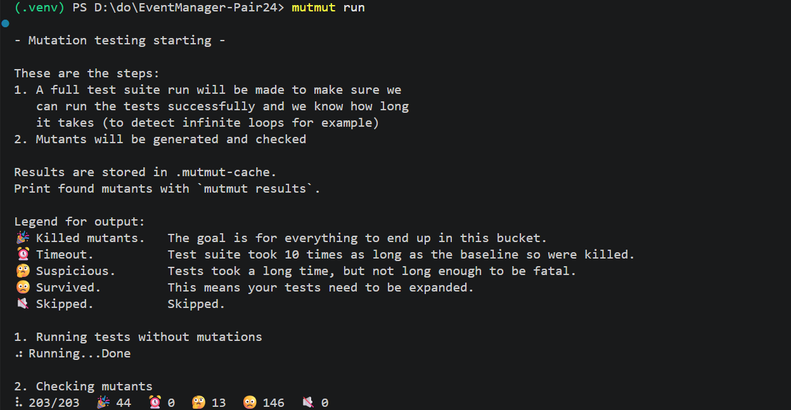

### 2.2 Baseline results (`mutmut results`)

The numbers below are **mutant IDs**, not line numbers. Use `mutmut show <id>` to see a specific change.

- **Suspicious (13):** `models.py` (12): 36-37, 39, 53-54, 56, 68-73 · `events.py` (1): 106
- **Survived (146):** `database.py` (10): 1-10 · `main.py` (8): 11-18 · `models.py` (39): 20-25, 27-29, 31-32, 34, 38, 41-52, 55, 57-61, 63-64, 66-67, 74-77 · `events.py` (14): 98-100, 103, 107-108, 120, 126-130, 136-137 · `schemas.py` (15): 79, 81-85, 89-97

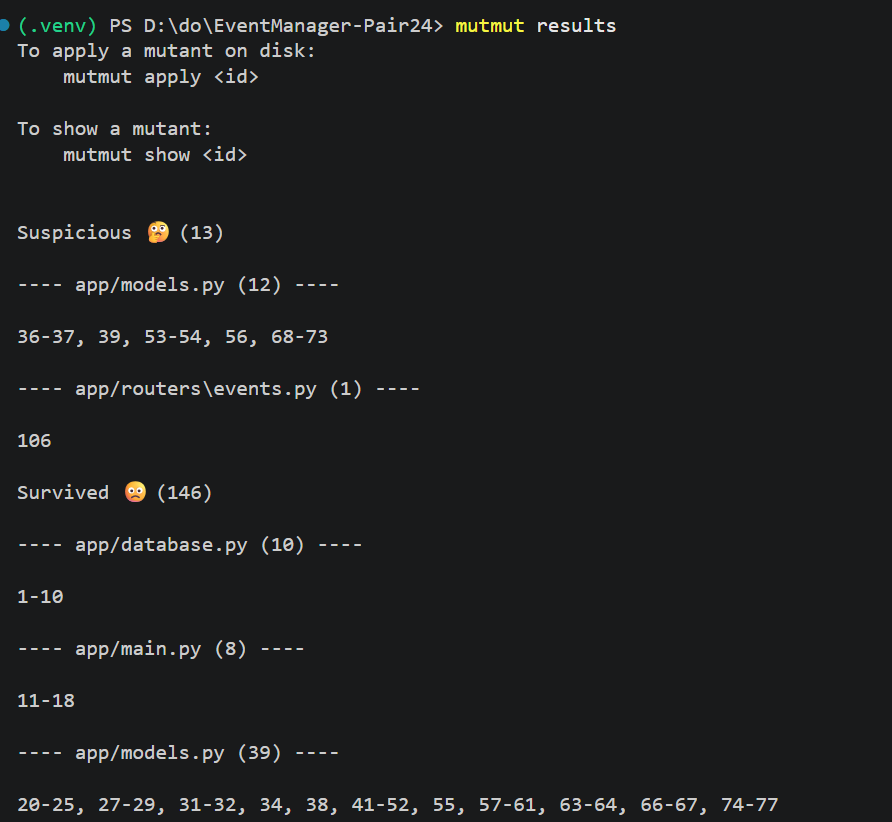

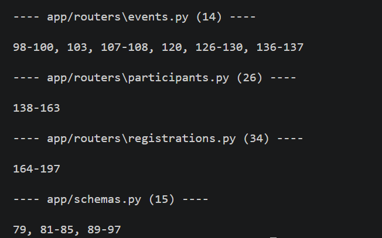

### 2.3 Baseline inspection (`mutmut show 4`)

```diff
 engine = create_engine(
     DATABASE_URL,
-    connect_args={"check_same_thread": False}
+    connect_args={"check_same_thread": True}
 )
```

This setting only affects thread safety for SQLite. The tests run in one thread, so they cannot detect the change. This mutant is in shared code (`database.py`), not in the Events domain.

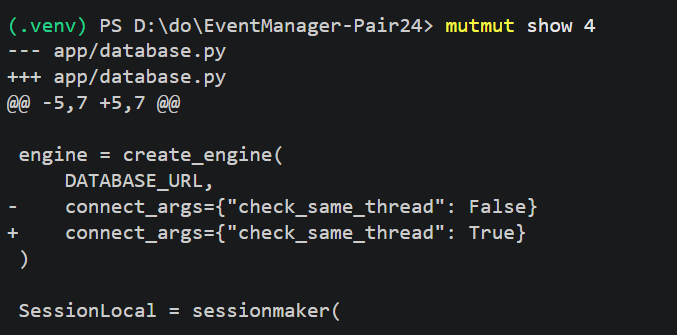

### 2.4 Baseline HTML report

Killed 44 out of 203 mutants.

| File | Total | Killed | % killed | Survived |
|---|---|---|---|---|
| app/database.py | 10 | 0 | 0.00 | 10 |
| app/main.py | 8 | 0 | 0.00 | 8 |
| app/models.py | 59 | 8 | 13.56 | 39 |
| app/schemas.py | 20 | 5 | 25.00 | 15 |
| app/routers/events.py | 40 | 25 | 62.50 | 14 |
| app/services/search.py | 6 | 6 | 100.00 | 0 |

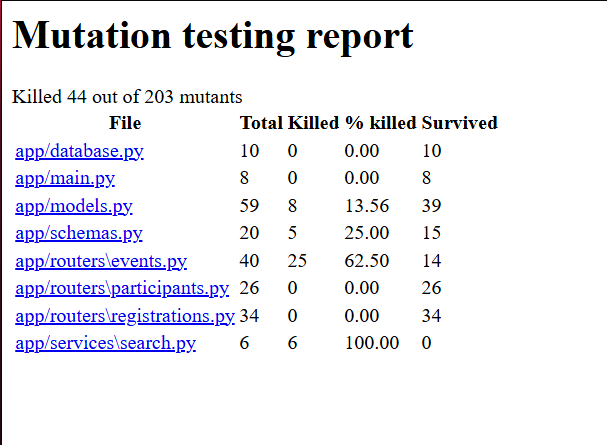

### 2.5 Second mutation run (after Student A tests)

Command: `mutmut run`

- Baseline test run: Done
- Mutants checked: **203/203**
- Killed **53**, Timeout 0, Suspicious **13**, Survived **137**, Skipped 0

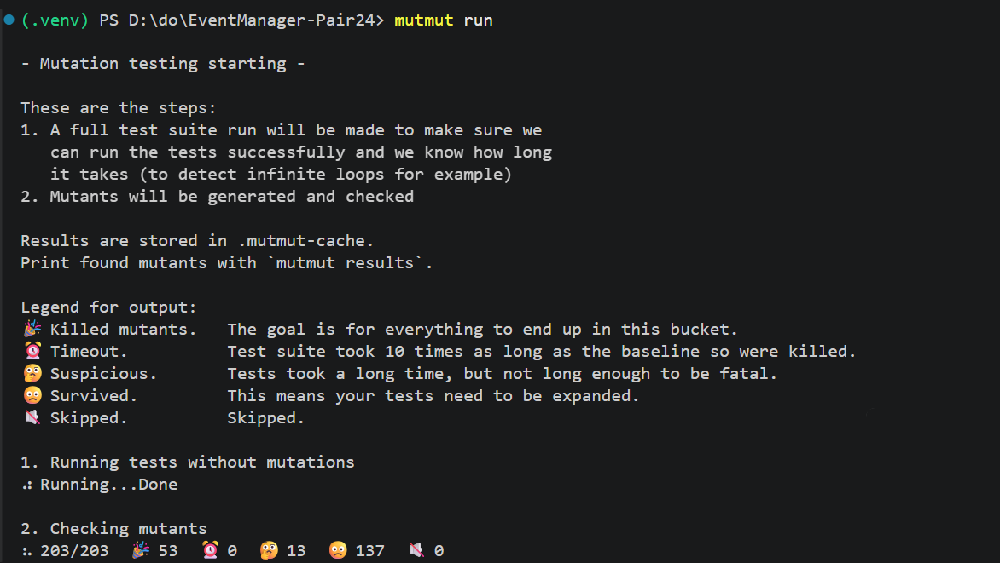

### 2.6 Second results (`mutmut results`)

- **Suspicious (13):** `models.py` (12): 36-37, 39, 53-54, 56, 68-73 · `events.py` (1): 106
- **Survived (142):** `database.py` (10): 1-10 · `main.py` (8): 11-18 · `models.py` (39): 20-25, 27-29, 31-32, 34, 38, 41-52, 55, 57-61, 63-64, 66-67, 74-77 · `events.py` (14): 98-100, 103, 107-108, 120, 126-130, 136-137 · `schemas.py` (11): 81-82, 89-97

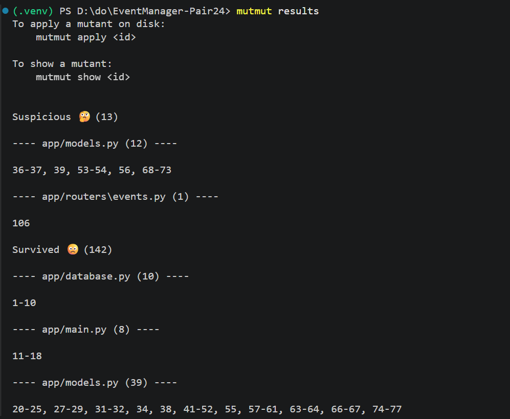

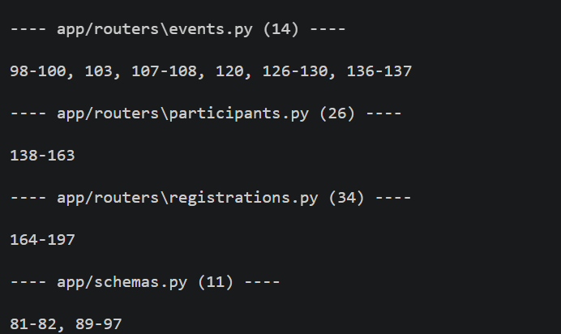

### 2.7 Second HTML report

The report says **Killed 48 out of 203 mutants**.

| File | Total | Killed | % killed | Survived |
|---|---|---|---|---|
| app/database.py | 10 | 0 | 0.00 | 10 |
| app/main.py | 8 | 0 | 0.00 | 8 |
| app/models.py | 59 | 8 | 13.56 | 39 |
| app/schemas.py | 20 | 9 | 45.00 | 11 |
| app/routers/events.py | 40 | 25 | 62.50 | 14 |
| app/services/search.py | 6 | 6 | 100.00 | 0 |

**Note:** The HTML report and `mutmut results` (48 killed, 142 survived) do not match the run summary (53 killed, 137 survived). The run summary is the most recent. See Open Issues.

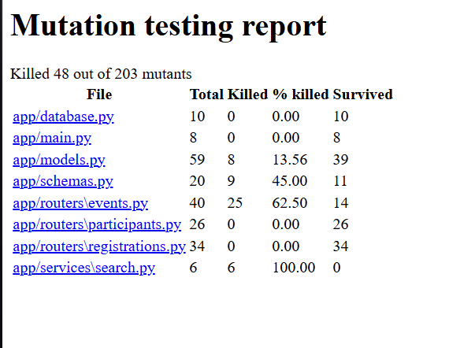

---

## Section 3: Evaluation & Deliverables

**Target metric:** Mutation Score = (Killed Mutants / Total Mutants) × 100%

**Mutation score (latest run):** 53 / 203 = **26.1%** 

**Code coverage (latest run):** **77%**

---

